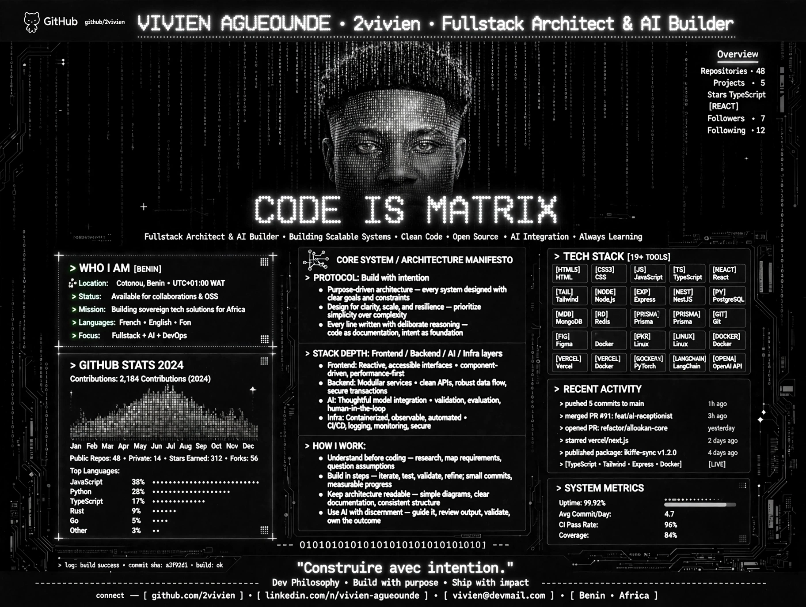

---

### VIVIEN AGUEOUNDE

**`2vivien`** — Fullstack Architect & AI Builder

Construire avec intention. *Purpose-driven architecture, clean APIs,
thoughtful AI integration, observable infrastructure.*

**Cotonou, Benin • UTC+01:00** — Available for collaborations & OSS

[

<b>Full profile — text version (for search engines &amp; screen readers)</b>

### &gt; WHO I AM [BENIN]

- **Location:** Cotonou, Benin • UTC+01:00 WAT
- **Status:** Available for collaborations &amp; OSS
- **Mission:** Building sovereign tech solutions for Africa
- **Languages:** French • English • Fon
- **Focus:** Fullstack + AI + DevOps

### &gt; CORE SYSTEM / ARCHITECTURE MANIFESTO

**&gt; PROTOCOL: Build with intention**

- Purpose-driven architecture — every system designed with clear goals and constraints
- Design for clarity, scale, and resilience — prioritize simplicity over complexity
- Every line written with deliberate reasoning — code as documentation, intent as foundation

**&gt; STACK DEPTH: Frontend / Backend / AI / Infra layers**

- **Frontend:** Reactive, accessible interfaces • component-driven, performance-first
- **Backend:** Modular services • clean APIs, robust data flow, secure transactions
- **AI:** Thoughtful model integration • validation, evaluation, human-in-the-loop
- **Infra:** Containerized, observable, automated • CI/CD, logging, monitoring, secure

**&gt; HOW I WORK:**

- Understand before coding — research, map requirements, question assumptions
- Build in steps — iterate, test, validate, refine; small commits, measurable progress
- Keep architecture readable — simple diagrams, clear documentation, consistent structure
- Use AI with discernment — guide it, review output, validate, own the outcome

### &gt; TECH STACK [19+ TOOLS]

`HTML5` `CSS3` `JavaScript` `TypeScript` `React` `Tailwind` `Node.js` `Express`
`NestJS` `Python` `PostgreSQL` `MongoDB` `Redis` `Prisma` `Git` `Figma` `Docker`
`Linux` `Vercel` `PyTorch` `LangChain` `OpenAI` `GraphQL`

### &gt; RECENT ACTIVITY

- pushed 5 commits to main — _1h ago_
- merged PR #91: feat/ai-receptionist — _3h ago_
- opened PR: refactor/alloakan-core — _yesterday_
- starred vercel/next.js — _2 days ago_
- published package: ikiffe-sync v1.2.0 — _4 days ago_

### &gt; SYSTEM METRICS

Uptime **99.92%** • Avg Commit/Day **4.7** • CI Pass Rate **96%** • Coverage **84%**

> log: build success • commit sha: a3f92d1 • build: ok

