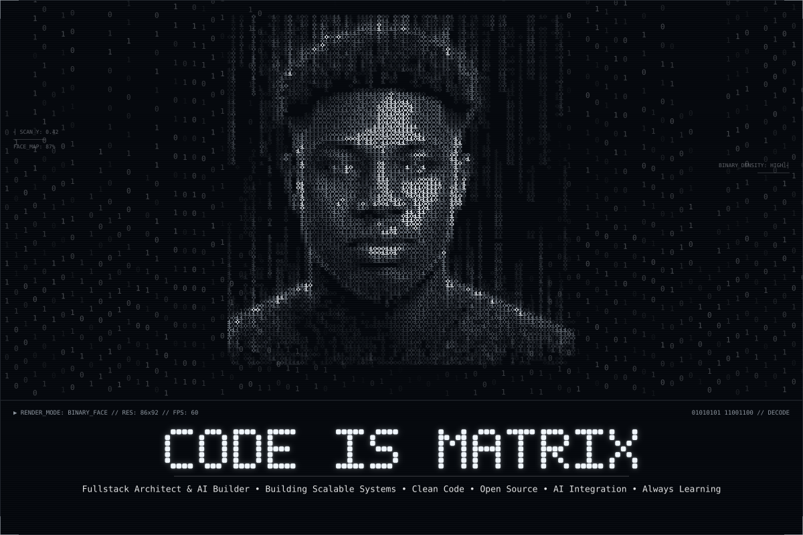
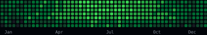
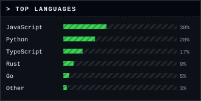
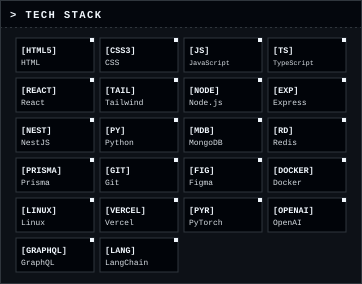
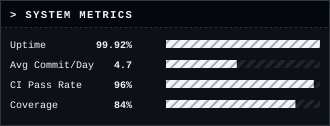

<pre>
┌────────────────────────────────────────────────────────────────────────────────┐
│ <b>VIVIEN AGUEOUNDE</b> • 2vivien • Fullstack Architect &amp; AI Builder   <b>BENIN // 229</b> │
└────────────────────────────────────────────────────────────────────────────────┘
</pre>

<table>
<tr>
<td width="33%" valign="top">

<h3>&gt; WHO I AM [BENIN]</h3>

🟢 <b>Location:</b> &nbsp;Cotonou, Benin • UTC+01:00 WAT 
🟢 <b>Status:</b> &nbsp;&nbsp;&nbsp;&nbsp;Available for collaborations &amp; OSS 
🟢 <b>Mission:</b> &nbsp;&nbsp;Building sovereign tech solutions for Africa 
🟢 <b>Languages:</b> French • English • Fon 
🟢 <b>Focus:</b> &nbsp;&nbsp;&nbsp;&nbsp;Fullstack + AI + DevOps

<h3>&gt; GITHUB STATS 2024</h3>

<b>Contributions: 2,184</b> Contributions (2024)

<b>Public Repos: 48</b> • Private: 14 • Stars Earned: 312 • Forks: 56

</td>
<td width="34%" valign="top">

<h3>&gt; CORE SYSTEM / ARCHITECTURE MANIFESTO</h3>

<b>&gt; PROTOCOL: Build with intention</b>

▸ <b>Purpose-driven architecture</b> — every system designed with clear goals and constraints 
▸ <b>Design for clarity, scale, and resilience</b> — prioritize simplicity over complexity 
▸ <b>Every line written with deliberate reasoning</b> — code as documentation, intent as foundation

<b>&gt; STACK DEPTH: Frontend / Backend / AI / Infra layers</b>

▸ <b>Frontend:</b> Reactive, accessible interfaces • component-driven, performance-first 
▸ <b>Backend:</b> Modular services • clean APIs, robust data flow, secure transactions 
▸ <b>AI:</b> Thoughtful model integration • validation, evaluation, human-in-the-loop 
▸ <b>Infra:</b> Containerized, observable, automated • CI/CD, logging, monitoring, secure

<b>&gt; HOW I WORK:</b>

▸ <b>Understand before coding</b> — research, map requirements, question assumptions 
▸ <b>Build in steps</b> — iterate, test, validate, refine; small commits, measurable progress 
▸ <b>Keep architecture readable</b> — simple diagrams, clear documentation, consistent structure 
▸ <b>Use AI with discernment</b> — guide it, review output, validate, own the outcome

</td>
<td width="33%" valign="top">

<h3>&gt; RECENT ACTIVITY</h3>

🟢 pushed 5 commits to main &nbsp;1h ago 
🟢 merged PR #91: feat/ai-receptionist &nbsp;3h ago 
🟢 opened PR: refactor/alloakan-core &nbsp;yesterday 
🟢 starred vercel/next.js &nbsp;2 days ago 
🟢 published package: ikiffe-sync v1.2.0 &nbsp;4 days ago

</td>
</tr>
</table>

---

### `— 010101010101010101010101010101 —`

# "Construire avec intention."

**Dev Philosophy • Build with purpose • Ship with impact**

### `— 010101010101010101010101010101 —`

<pre>
connect — [ github.com/2vivien ] • [ linkedin.com/m/vivien-agueounde ] • [ vivien@devmail.com ] • [ Benin • Africa ]
</pre>

> log: build success • commit sha: a3f92d1 • build: ok

